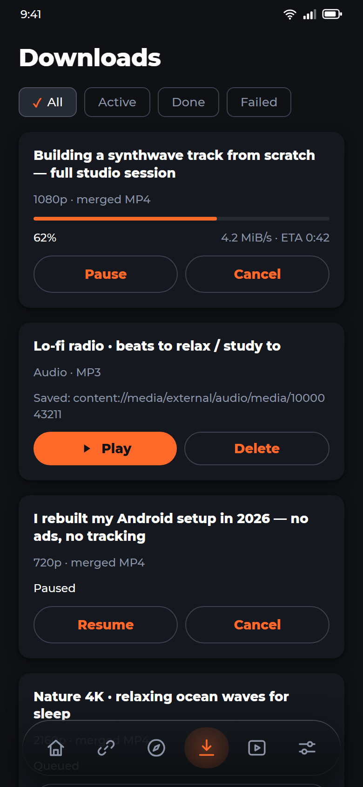
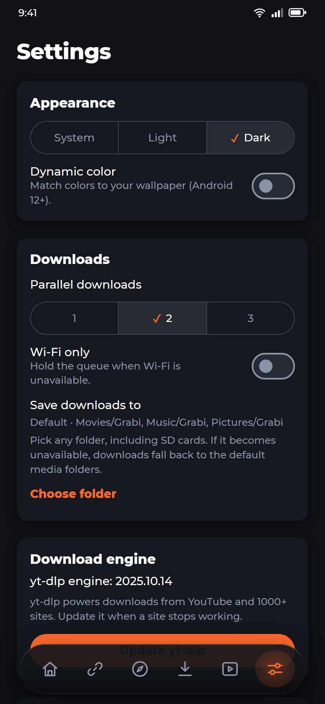

# Grabi

[](https://github.com/raicore-official/grabi/actions/workflows/build.yml)
[](https://github.com/raicore-official/grabi/releases)
[](LICENSE)
[](https://developer.android.com/about/versions/oreo)

Open-source, VidMate-style video downloader and player for Android. No ads, no tracking, no API keys.
Original developer: **Raisul Islam** ([Raisulxislam](https://github.com/Raisulxislam)) · Raisoft Studio.

> **Status: v0.1.0 released · Phase 8 on main.** All seven roadmap phases are done: shell, yt-dlp engine, download manager, Media3 player, built-in browser (tabs, incognito, site grid, video/audio/image detection, EasyList/EasyPrivacy/uBlock adblock with per-site allowlist), WireGuard VPN (config import, country-organized community config finder, handshake verification, kill switch, split tunneling) and release polish (crash capture, F-Droid metadata, GitHub Releases). Phase 8 adds the native YouTube feed, the dedicated Grab tab, glassy icon-only navigation, SAF download destinations, manual engine updates and screen-off playback fixes. Backlog items are marked below.

## Screenshots

Design renderings of the current UI (pixel-faithful HTML/CSS replicas of the Compose screens at 2× scale), not device captures.

| Home — native feed | Grab — paste to download | Browser — detection sheet |
|---|---|---|
|  |  |  |

| Downloads — live queue | Settings |
|---|---|
|  |  |

## Features

| Area | Feature | Phase |
|---|---|---|
| Shell | Material 3 dark-first UI, floating glassy icon-only bottom nav (Home · Grab · Browser · Downloads · Library · Settings), Montserrat/charcoal-ember theme, dynamic color option | 1 ✅ |
| Downloader | yt-dlp engine (1000+ sites), paste/share links, 144p–4K + mp3/m4a/opus picker, English subtitles, background yt-dlp auto-update, cancel | 2 ✅ |
| Downloader+ | Playlist/batch downloads | backlog |
| Download manager | Room-backed queue, foreground service + WorkManager recovery, pause/resume/retry/cancel/delete, 1–3 parallel downloads, Wi-Fi-only, speed/ETA notifications, MediaStore publish (Android 10+), aria2 for direct media links, filters | 3 ✅ |
| Player | Media3/ExoPlayer, NewPipeExtractor YouTube streaming without an API key, quality/speed pickers, video-only+audio merging, PiP, audio-only mode with MediaSession background playback, resume positions, history, favorites, in-player download button, offline playback of completed downloads | 4 ✅ |
| Browser | Tabbed WebView behind a swappable `BrowserEngine` interface, popular-site grid, DuckDuckGo search, incognito tabs, floating download button, video/audio/**image** detection, EasyList/EasyPrivacy/uBlock adblock with auto-update and per-site allowlist, browser history | 5 ✅ |
| VPN | WireGuard via the official embeddable tunnel library, import configs (paste/file/URL), runtime country-organized config finder across public GitHub sources (nothing bundled, untrusted-server warnings), handshake verification before “connected”, kill switch, split tunneling, always-on VPN integration. No hardcoded servers or keys | 6 ✅ |
| VPN+ | Outline/sing-box providers behind the `TunnelBackend` seam, QR import | backlog |
| Release | Crash capture with shareable crash log in Settings → About, F-Droid fastlane metadata, GitHub Releases (signed when secrets are set, debug-signed fallback otherwise) | 7 ✅ |
| Native experience | Home = native YouTube feed (trending/music/gaming/… kiosks + search via NewPipeExtractor, no API key) with the brand logo in the header; dedicated **Grab** tab for universal paste/share/page-offer → format picker → live download card; SAF download destination picker; manual yt-dlp update button; screen-off & audio-only playback fixes; browser detection sheet split into *Video & audio* / *Images* | 8 ✅ |

## Architecture

Single Gradle module (`:app`), clean-architecture packages, unidirectional data flow:

```
┌──────────────────────────────────────────────────────────┐
│ ui/            Jetpack Compose + Material 3              │
│   screens/*    Home · Grab · Browser · Downloads ·       │
│                Library · Settings (StateFlow ViewModels) │
│   navigation/  bottom-nav graph, state-preserving tabs   │
│   theme/       Raisoft charcoal/ember tokens, Montserrat │
├──────────────────────────────────────────────────────────┤
│ domain/        pure Kotlin: models, LinkValidator,       │
│                MediaFormatMapper, StreamOptionMapper,    │
│                CountryClassifier, WgConfigUtils          │
├──────────────────────────────────────────────────────────┤
│ data/          settings (DataStore) ✅                    │
│                download engine (yt-dlp + ffmpeg) ✅ P2    │
│                db (Room: downloads ✅ P3, library ✅ P4)  │
│                stream (NewPipeExtractor) ✅ P4            │
│                playback (Media3 session service) ✅ P4    │
│                browser (tabs, WebView engine) ✅ P5       │
│                adblock (filter lists, matcher) ✅ P5      │
│                vpn (WireGuard backend, finder) ✅ P6    │
│                crash (local crash capture) ✅ P7        │
└──────────────────────────────────────────────────────────┘
        Hilt wires everything · coroutines/Flow throughout
```

## Build

All official builds happen on **GitHub Actions** (`.github/workflows/build.yml`): every push to `main`, every PR, and manual dispatch run `assembleDebug`, unit tests and lint on JDK 17 with Gradle caching, then upload the debug APK as an artifact. Download it from the latest green run: **Actions → Build → Artifacts → grabi-debug-apk**. Install with `adb install app-debug.apk` (enable "Install unknown apps").

Local build (optional, needs JDK 17 + Android SDK 34):

```bash
./gradlew assembleDebug        # APK at app/build/outputs/apk/debug/
./gradlew testDebugUnitTest    # unit tests
./gradlew lintDebug            # lint
```

Requirements: minSdk 26 (Android 8.0), targetSdk 34, Kotlin 2.0.21, AGP 8.5.2, Gradle 8.9.

## Download engine (Phase 2)

- `YtDlpEngine` wraps [youtubedl-android](https://github.com/yausername/youtubedl-android) 0.18.1 (`library` + `ffmpeg` artifacts). Init is lazy, mutex-guarded and off the main thread; the app warms it up at startup and then auto-updates the yt-dlp binary from the STABLE GitHub channel in the background.
- Flow: paste a link or share text to Grabi (`ACTION_SEND`) → `--dump-json` info fetch → `MediaFormatMapper` builds the picker (every available height up to 4K as merged MP4, plus MP3/M4A/Opus audio extraction) → download with live percent/ETA and cancel (`destroyProcessById`).
- Video downloads merge best video + best audio into MP4 via the bundled ffmpeg; audio uses `-x --audio-format`. Optional English subtitles are written as `.srt`.
- Phase 2 output goes to the app-specific external folder `Android/data/com.raisoft.grabi/files/Grabi` (no storage permission needed). MediaStore/SAF export, the persistent queue and pause/resume arrive with the Phase 3 download manager.
- Playlists are intentionally out of scope in Phase 2 (`--no-playlist`); batch downloads remain on the backlog (Phase 4+). NewPipeExtractor + core-library desugaring land in Phase 4 with the player.

## Download manager (Phase 3)

- Every download is a Room row (`downloads` table), so the queue survives process death and app restarts. `DownloadManager` runs up to N jobs concurrently (Settings → Downloads → 1/2/3) and pumps the queue on enqueue, settings change, network change and app resume.
- `DownloadService` is a `dataSync` foreground service with a summary notification; each job gets its own progress notification with percent, speed and ETA plus Pause/Cancel actions. Done/failed notifications offer Open/Retry/Dismiss.
- Pause kills the yt-dlp process and keeps the `.part` file; resume re-runs the same command and yt-dlp continues from the partial file. Cancel/retry/delete behave as expected; delete also removes the published MediaStore entry or app-dir file.
- Wi-Fi-only holds queued jobs in `WAITING_WIFI` and releases them when a Wi-Fi network becomes active (ConnectivityManager callback).
- On Android 10+ finished files are published to `Movies/Grabi` or `Music/Grabi` via MediaStore (visible to gallery/music apps); older versions keep the app-specific file and share it through a FileProvider.
- Direct media links (`.mp4`, `.mkv`, `.mp3`, …) use the bundled aria2c as yt-dlp's external downloader for segmented downloads; site pages use yt-dlp's native downloader.
- WorkManager (`QueueRecoveryWorker`, network-constrained) plus startup recovery reset stale `RUNNING` rows to `QUEUED` after a process kill, so interrupted downloads resume automatically.

## Player & library (Phase 4)

- `StreamRepository` resolves playable URLs: YouTube links go through **NewPipeExtractor v0.27.1** (no API key) — progressive streams plus video-only streams paired with the best audio track; other http(s) links and local files play directly. Extraction runs on `Dispatchers.IO` with an OkHttp-backed `Downloader` (`NewPipe.init` at app startup).
- `PlaybackService` is a `MediaSessionService` (`mediaPlayback` foreground type) owning the ExoPlayer instance, so playback survives the UI going away. The UI drives it through a `MediaController`; a custom `SET_MEDIA` session command lets the service build a `MergingMediaSource` (video-only + audio) which a plain `MediaItem` cannot express.
- Quality picker lists every extracted resolution (highest first); switching keeps the current position. Speed picker: 0.5×–2×. Audio-only mode swaps to the best audio stream and keeps playing in the background with the system media notification (lock screen / Bluetooth controls via MediaSession).
- Picture-in-picture: 16:9 mini player on devices that support it (Android 8+).
- Library tab: **History** (last 100 plays, resume positions saved every 5 s and on pause), **Favorites**, and **Downloads** (completed files play offline in the same player). Thumbnails load with Coil. The player also has a Download button that queues the best-quality yt-dlp download of the current video.
- A second Room database (`grabi-library.db`) holds history/favorites so the Phase 3 downloads schema stays untouched.
- Core-library desugaring (`desugar_jdk_libs_nio`) is enabled for NewPipeExtractor's `java.time`/stream usage below API 33.

## Browser, detection & adblock (Phase 5)

- **Swappable engine:** UI talks to a `BrowserEngine` interface; `WebViewEngine` is the current implementation (WebView created with application context, retained per tab). Up to 8 tabs; normal tabs persist across restarts (DataStore JSON), engines are created lazily and destroyed on close.
- **Incognito:** per-tab flag — no history recording, DOM storage/form data/cache disabled, and cookies are cleared when the last incognito tab closes. Honest limitation: WebView has one cookie jar per process, so cookies are shared with normal tabs *while* an incognito tab is open.
- **Search & navigation:** URL bar loads URLs directly, upgrades bare hosts to https, and sends anything else to DuckDuckGo (no API key). New tabs show a popular-site grid. Back/forward/reload, progress bar, browser history sheet with clear.
- **Media detection:** `shouldInterceptRequest` classifies every subresource with the pure `MediaSniffer` (extension + MIME rules) into video/audio/image; detections are deduped per tab (cap 50) and surfaced in the floating download button's sheet. Detected videos/audio queue through yt-dlp; **images download via a new OkHttp `DirectDownloader`** integrated into the same Room queue (progress, pause/cancel, MediaStore `Pictures/Grabi` on Android 10+). “Download this page” sends the page URL to the Grab tab's yt-dlp flow for site players (YouTube etc.).
- **Adblock:** `AdblockEngine` fetches EasyList + EasyPrivacy + uBlock filters on first browser use and auto-refreshes when older than 7 days (manual update in Settings/menu). The lean Kotlin `FilterListParser` compiles `||domain^`, `@@` exceptions, `||domain/path` and plain substring rules into hash-set/suffix matchers — O(1) per request. Rules with options (`$third-party`, `$domain=`) and cosmetic rules are deliberately skipped: under-block rather than break sites. Per-site allowlist lives in Settings; blocked requests get an empty response.
- `usesCleartextTraffic` is enabled because a browser must open http:// sites; everything else stays TLS-first.

## VPN (Phase 6)

- **Engine:** the official [wireguard-android](https://github.com/WireGuard/wireguard-android) embeddable `tunnel` artifact (1.0.20260102, Apache-2.0) with the wireguard-go userspace backend — no root, no external app. `WireGuardBackend` implements a small `TunnelBackend` interface so other protocols (Outline/sing-box) can be added later without touching the UI or state machine. The library's `GoBackend$VpnService` is merged from its own manifest; Grabi adds no VPN service of its own.
- **Nothing hardcoded:** no servers, keys or configs ship in the app. Configs come from (a) **import** — paste text, pick a `.conf` file (SAF), or fetch a URL; (b) the **finder** — at runtime it searches public GitHub repositories (three queries, ≤6 repos, ≤24 candidates), downloads `.conf` files, keeps only ones that parse and have a peer endpoint, dedupes by endpoint+key, and groups them by country inferred from file/path/repo names (16 common countries + extras, `CountryClassifier`). Results are cached for an hour and labeled with their source repository.
- **Trust model:** community configs are explicitly marked *untrusted* — the server operator can observe traffic and public keys are often shared account keys. Connecting to one requires an explicit risk-acceptance dialog. Importing a config from a server you control is the recommended path and is labeled differently.
- **Verification:** after the tunnel comes up, the repository polls per-peer statistics for up to 15 s and only reports **Connected** once a real WireGuard handshake (`latestHandshakeEpochMillis`) is observed. No handshake → automatic disconnect with a clear error, so dead configs never look “connected”.
- **Kill switch (on by default):** if an established tunnel drops unexpectedly, Grabi immediately brings up a generated blackhole tunnel (fresh random keys, endpoint 127.0.0.1:9, all routes) through the same backend, so traffic is blocked instead of leaking onto the normal connection mid-session. Reconnecting replaces it automatically; turning the kill switch off releases it. Failed connection attempts do *not* trigger the block. For OS-level guarantees the screen shows always-on/lockdown status and links to the system VPN settings; with system always-on enabled, Android restarts the tunnel service after process death and Grabi auto-reconnects the last config (`GoBackend.setAlwaysOnCallback`).
- **Split tunneling:** per-app exclude list (launchable apps picker) written into the config's `ExcludedApplications` attribute, which the backend applies via `VpnService.Builder.addDisallowedApplication`. Applies on the next connect.
- **Storage:** configs (including private keys) live in app-private DataStore; `allowBackup=false` keeps them out of cloud backups. Tunnel names follow WireGuard's 15-char `[a-zA-Z0-9_=+.-]` rule (`WgConfigUtils.sanitizeName`).
- **Crash safety:** all backend calls are wrapped and run on `Dispatchers.IO`; unexpected `onStateChange(DOWN)` callbacks drive the state machine instead of crashing it; the repository is created eagerly at app startup so the always-on callback is always registered.

### Signing a release

Releases build on tag push (`v*`) via `.github/workflows/release.yml`. Create a keystore **locally, never commit it**:

```bash
keytool -genkeypair -v -keystore grabi-release.jks -alias grabi \
  -keyalg RSA -keysize 2048 -validity 10000
base64 -w0 grabi-release.jks > keystore.b64   # Git Bash; on macOS: base64 -i grabi-release.jks
```

Add four repository secrets (Settings → Secrets and variables → Actions): `KEYSTORE_BASE64` (contents of keystore.b64), `KEYSTORE_PASSWORD`, `KEY_ALIAS` (`grabi`), `KEY_PASSWORD`. Then `git tag v0.1.0 && git push origin v0.1.0`. The workflow signs the APK and publishes it to GitHub Releases with auto-generated notes. Keep the keystore backed up — losing it means you can never update the app under the same signature.

**Signing is optional:** if any of the four secrets is missing, the workflow warns and publishes a **debug-signed APK** instead — installable via sideloading, but it cannot update an install signed with a different key. Add the secrets and push a new tag to switch to properly signed releases automatically.

### F-Droid

Store metadata lives in `fastlane/metadata/android/en-US/` (title, short/full description, per-versionCode changelogs) and is picked up automatically by F-Droid's build server. Getting listed is a community process, done outside this repo:

1. Fork [fdroiddata](https://gitlab.com/fdroid/fdroiddata) on GitLab.
2. Add `metadata/com.raisoft.grabi.yml` (copy an existing GPL app as a template): `Repo Type: git`, `Repo: https://github.com/raicore-official/grabi`, and a build block with `versionName: 0.1.0`, `versionCode: 1`, `commit: v0.1.0`, `gradle: yes`.
3. Validate locally with `fdroid lint` / `fdroid build` if you can, then open a merge request and respond to reviewer feedback.

F-Droid builds from source and signs with its own key, so no keystore secrets are needed for that channel. Screenshots (optional but recommended) go in `fastlane/metadata/android/en-US/images/phoneScreenshots/`.

## Native experience (Phase 8)

- **Home is a native feed, not a paste box.** `FeedRepository` talks to NewPipeExtractor's YouTube kiosks (Trending, Music, Gaming, …) and search — no API key, no WebView. Results render as thumbnail cards with view counts, duration, uploader avatar and a one-tap download action; kiosk results are cached per session. The header is just a YouTube search field with the Grabi logo in the top-right corner.
- **Grab tab owns paste-to-download.** The universal link field (clipboard paste button, `ACTION_SEND` shares, browser “Download this page” offers and feed download taps all route here), the format picker (144p–4K merged MP4 + MP3/M4A/Opus, subtitles switch) and the live download card (percent/speed/ETA, pause/resume/retry/cancel) live on their own destination, so Home stays a clean browsing surface.
- **Glassy icon-only navigation.** Floating pill bar with a translucent charcoal gradient, hairline top light, per-tab ember glow and custom stroke icons matched to the logo; six destinations, state-preserving switches.
- **Playback fixes.** ExoPlayer is built with `C.WAKE_MODE_NETWORK` so screen-off and audio-only background playback keep their wake lock; audio becoming noisy pauses playback.
- **Engine fixes & updates.** yt-dlp init now also extracts FFmpeg and aria2c (missing before, which broke merges/direct links); downloads pass `--no-simulate --progress` so `--print`-style info flags no longer suppress progress. Settings → Download engine shows the binary version and a manual **Update yt-dlp** button (STABLE channel) on top of the background auto-update.
- **Download destination.** Settings → Downloads opens the system folder picker (SAF); finished files are copied into the chosen tree via `DocumentsContract`, with MediaStore as the default/fallback. The folder's display name is resolved from the tree document.
- **Detection sheet sections.** The browser's floating download sheet splits detections into *Video & audio* and *Images* chips with counts, plus the page-level video offer for MSE players like YouTube.

## Open-source libraries

| Library | Repo | License | Purpose | Why chosen |
|---|---|---|---|---|
| Kotlin + coroutines | [JetBrains/kotlin](https://github.com/JetBrains/kotlin) | Apache-2.0 | Language, async/Flow | Required stack |
| Jetpack Compose + Material 3 | [androidx](https://github.com/androidx/androidx) | Apache-2.0 | Declarative UI | Required stack, modern tooling |
| Navigation Compose | androidx | Apache-2.0 | Bottom-nav graph | Official, state-preserving tabs |
| Hilt (+ KSP) | [google/dagger](https://github.com/google/dagger) | Apache-2.0 | DI | Official; KSP avoids heavy kapt |
| DataStore | androidx | Apache-2.0 | Settings persistence | Official SharedPreferences replacement |
| Room | androidx | Apache-2.0 | Download queue DB (P3 ✅), history/favorites (P4 ✅) | Official, Flow-native |
| WorkManager | androidx | Apache-2.0 | Queue recovery after process death (P3 ✅) | Official, survives process death |
| yt-dlp | [yt-dlp/yt-dlp](https://github.com/yt-dlp/yt-dlp) | Unlicense | Main download engine, 1000+ sites | De-facto standard, very active |
| youtubedl-android | [yausername/youtubedl-android](https://github.com/yausername/youtubedl-android) | GPL-3.0 | Bundles yt-dlp + Python for Android; optional ffmpeg/aria2c artifacts | Powers Seal/dvd; now on Maven Central as `io.github.junkfood02.youtubedl-android:0.18.1` |
| NewPipeExtractor | [TeamNewPipe/NewPipeExtractor](https://github.com/TeamNewPipe/NewPipeExtractor) | GPL-3.0-or-later | YouTube extraction/streaming without API key (P4 ✅) | Battle-tested in NewPipe, active |
| aria2 | [aria2/aria2](https://github.com/aria2/aria2) | GPL-2.0-or-later | Segmented direct-link downloads (P3 ✅, via youtubedl-android artifact) | Fast multi-connection downloader |
| FFmpeg | [FFmpeg/FFmpeg](https://github.com/FFmpeg/FFmpeg) | LGPL-2.1+ (build-dependent) | Muxing/remux to mp4/mp3 (P2, via youtubedl-android artifact) | Standard media toolchain |
| Media3/ExoPlayer | [androidx/media](https://github.com/androidx/media) | Apache-2.0 | Player, MediaSession, PiP (P4 ✅) | Official ExoPlayer successor |
| OkHttp | [square/okhttp](https://github.com/square/okhttp) | Apache-2.0 | Extractor HTTP (P4 ✅), filter lists + image downloads (P5 ✅) | Lean, maintained |
| Coil | [coil-kt/coil](https://github.com/coil-kt/coil) | Apache-2.0 | Thumbnails (P4 ✅) | Kotlin-first, Compose-native |
| adblock-rust *(optional upgrade)* | [brave/adblock-rust](https://github.com/brave/adblock-rust) | MPL-2.0 | High-performance filter engine (P5) | Brave-maintained; P5 starts with a lean Kotlin ABP parser, upgrade path if needed |
| wireguard-android | [WireGuard/wireguard-android](https://github.com/WireGuard/wireguard-android) | Apache-2.0 | Tunnel library + wireguard-go (MIT) backend (P6 ✅) | Official, embeddable tunnel; minSdk 24, all four ABIs bundled |
| Outline SDK *(backlog provider)* | [Jigsaw-Code/outline-sdk](https://github.com/Jigsaw-Code/outline-sdk) | Apache-2.0 | Outline key support via the `TunnelBackend` seam (backlog) | Maintained by Jigsaw/Google; needs a Go tun2socks build, deferred to keep P6 lean |
| Montserrat font | [JulietaUla/Montserrat](https://github.com/JulietaUla/Montserrat) | SIL OFL 1.1 | Brand typography | Raisoft brand font, OFL embeddable |
| JUnit 4 | [junit-team/junit4](https://github.com/junit-team/junit4) | EPL-1.0 | Unit tests (test-only) | Standard |

**Maintenance flags:** youtubedl-android moved from JitPack (`com.github.yausername`) to Maven Central under `io.github.junkfood02.youtubedl-android` (Seal's author). The old JitPack coordinates are stale — use the new ones. NewPipeExtractor ships via JitPack (`com.github.TeamNewPipe:NewPipeExtractor:v0.27.1`) and needs core-library desugaring (`desugar_jdk_libs_nio`, enabled in P4) below API 33. Versions in `gradle/libs.versions.toml` are pinned to verified-stable releases; Dependabot proposes weekly bumps.

## License

**Grabi is GPL-3.0-or-later.** This is forced, not a preference: NewPipeExtractor (GPL-3.0-or-later) and youtubedl-android (GPL-3.0) are copyleft, and linking them into the app makes the combined work GPL. Compatibility of everything else:

- Apache-2.0 (Compose, Hilt, Media3, OkHttp, Coil, wireguard-android, Outline) → GPL-compatible (one-way: Apache code can ship in a GPL app).
- MPL-2.0 (adblock-rust, if used) → file-level copyleft, GPL-3.0-compatible.
- Unlicense (yt-dlp) → public-domain equivalent, no restrictions.
- GPL-2.0-or-later (aria2) → "or later" lets it combine under GPL-3.0; it also runs as a separate process.
- LGPL (FFmpeg build) → compatible with GPL; verify the exact build flags of the bundled artifact in Phase 2.
- SIL OFL (Montserrat) → font embedding permitted; license text in `licenses/OFL-Montserrat.txt`.
- EPL-1.0 (JUnit) → test-only, never shipped in the APK.

Practical consequence: anyone distributing a modified Grabi must publish their source under GPL-3.0+. F-Droid friendly. **Not Google Play friendly** — YouTube downloading violates Play policy regardless of license; distribution is GitHub Releases + F-Droid only.

## Contributing

1. Fork, branch from `main`, keep changes scoped to one roadmap phase/feature.
2. Conventional commits (`feat:`, `fix:`, `chore:`, `ci:`, `docs:`).
3. `./gradlew assembleDebug testDebugUnitTest lintDebug` must pass (CI enforces it).
4. No proprietary dependencies, no analytics, no ads, no hardcoded servers/keys.
5. Open a PR; CI builds and uploads a test APK automatically.

## Risks & limitations

- **Site breakage:** YouTube changes frequently; yt-dlp/NewPipeExtractor need updates. yt-dlp binary auto-update (P2) mitigates; extractor bumps ship with app updates.
- **Play Store:** not distributable there (downloader policy). GitHub/F-Droid only.
- **DRM/EME:** WebView cannot play or download DRM-protected streams (Netflix etc.).
- **Scoped storage:** Android 10+ publishes finished files to MediaStore (`Movies/Grabi`, `Music/Grabi`) by default; Settings → Downloads can point every finished file at any SAF folder instead (copied via `DocumentsContract`, MediaStore fallback if the tree becomes unavailable). Android 8–9 keeps files in the app-specific external dir (uninstall deletes them).
- **Background limits:** Android 12+ blocks foreground-service starts from the background; if the OS kills the app mid-download, the queue resumes on next launch (WorkManager + startup recovery). Pause/resume restarts the yt-dlp process and continues the `.part` file rather than freezing it in place.
- **Player:** YouTube stream URLs are session-bound and expire; a stale history entry may need a re-resolve (Retry). PiP shows the whole player screen scaled down (controls included) rather than a video-only surface. Audio-only background playback relies on the media notification; some OEM battery killers still stop it.
- **Browser:** detection is extension/MIME-based — MSE/blob streams (YouTube's player) are not sniffed; use “Download this page” there. Adblock is network-level only (no cosmetic filtering, option rules skipped). Incognito shares the cookie jar while open (cleared on last incognito close). WebView fullscreen video (`onShowCustomView`) is not handled yet.
- **VPN:** community configs found by the finder are untrusted — their operators can see/log traffic, keys may be shared, and servers die without notice; the handshake check and risk dialog mitigate but cannot make them safe. Import your own config for real privacy. The kill switch blocks traffic through a blackhole tunnel while the app process is alive; if the OS kills the whole process, only the system always-on VPN + lockdown settings can guarantee no leak (the screen links to them). The tunnel lives in the app process, so force-stopping Grabi drops it. Split tunneling applies on reconnect. Finder depends on GitHub's unauthenticated API limits (a few searches per refresh, results cached 1 h) and on community repos existing — it can legitimately return nothing. Outline/sing-box and QR import are backlog.
- **GPL obligations:** distributing binaries requires offering source.
- **Low-end devices:** Python+yt-dlp startup is heavy; engine init is lazy and off the main thread (P2).

## Credits

Original developer: **Raisul Islam** ([Raisulxislam](https://github.com/Raisulxislam)), Raisoft Studio — design, brand and implementation.

yt-dlp · youtubedl-android (yausername / JunkFood02) · NewPipeExtractor (TeamNewPipe) · aria2 · FFmpeg · AndroidX/Jetpack (Google) · Dagger/Hilt (Google) · OkHttp (Square) · Coil · WireGuard · Outline (Jigsaw) · Brave adblock-rust · Montserrat (Julieta Ulanovsky et al.). Grabi is an independent project, not affiliated with VidMate or YouTube.