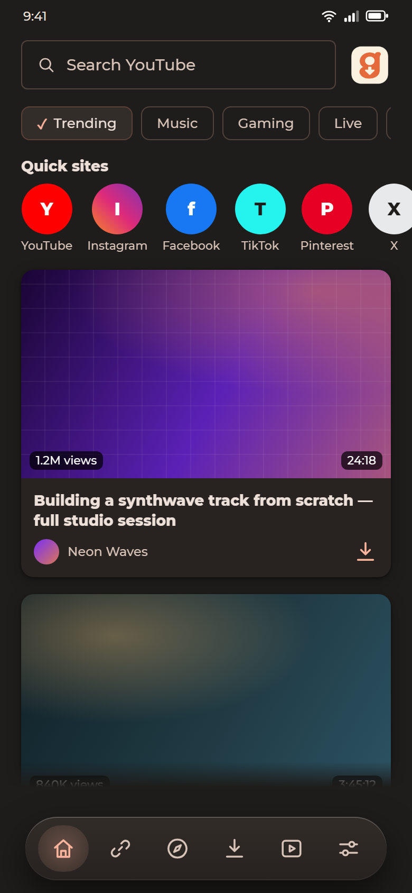
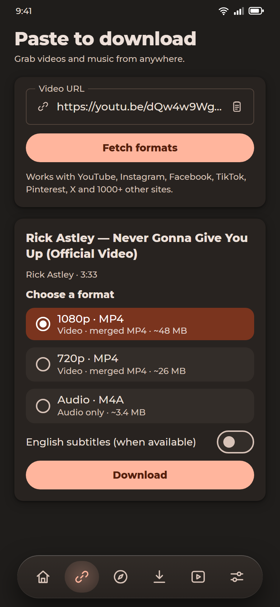
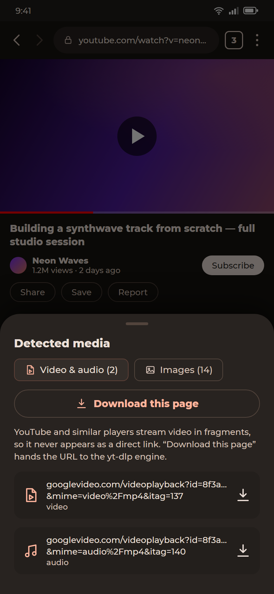

# Grabi

[](https://github.com/raicore-official/grabi/actions/workflows/build.yml)
[](https://github.com/raicore-official/grabi/releases)
[](LICENSE)
[](https://developer.android.com/about/versions/oreo)

Open-source, VidMate-style video downloader and player for Android. No ads, no tracking, no API keys.
Original developer: **Raisul Islam** ([Raisulxislam](https://github.com/Raisulxislam)) · Raisoft Studio.

## Screenshots

Design renderings of the current UI (pixel-faithful HTML/CSS replicas of the Compose screens at 2× scale), not device captures.

| Home — native feed | Grab — paste to download | Browser — detection sheet |
|---|---|---|
|  |  |  |

| Downloads — live queue | Settings |
|---|---|
|  |  |

## Features

- **Download anything** — paste a link (or share to Grabi) and pick a format: video, audio-only or image, with size estimates, subtitles and a live preview/thumbnail before you commit. yt-dlp engine with in-app updates, parallel queue, pause/resume/retry, Wi-Fi-only mode, SAF folder or MediaStore destinations.
- **Native feed & voice search** — YouTube trending/search rendered natively (NewPipeExtractor), one-tap download, system speech-recognition search (the same recognizer YouTube uses — no custom engine, no extra permission).
- **Player** — Media3/ExoPlayer with background & screen-off playback, audio-only mode, captions, speed control, fullscreen, related videos, and a retry chain that refreshes expired stream links automatically. Reopening a video resumes exactly where you left off and keeps playing — position is persisted by the playback service itself, so it survives process death.
- **Media notification** — play/pause/seek from the notification; tapping it returns to the app. Download notifications carry per-item Pause/Cancel/Resume/Retry plus a summary with Open / Pause all / Resume all.
- **Browser** — tabs, incognito, site grid, video/audio/image/file detection sheet, and a Grabi-managed download queue for browser links including APKs and documents. Downloads use resumable queue processing, parallel range requests where supported, pause/resume/cancel controls and progress notifications instead of bypassing Grabi through the platform downloader. EasyList/EasyPrivacy/uBlock adblock with per-site allowlist and darkened pages.
- **VPN** — WireGuard tunnels with config import, a country-organized community config finder (GitHub), handshake verification, kill switch (blackhole tunnel), split tunneling and always-on support.
- **AutoBot** — opt-in automation that discovers, validates, ranks and (with full automation enabled) safely replaces VPN configurations: syntax/key/endpoint validation, duplicate detection, expiry tracking with conservative clock handling, scheduled renewal via WorkManager, handshake + connectivity verification before commit, rollback to the previous config or kill-switch protection on failure, and expiry notifications. Providers that require human verification (VPNBook's Cloudflare Turnstile) are never bypassed — AutoBot reports them honestly and offers an assisted in-app browser import instead.
- **First-run setup** — branded loading screen, then optional permission onboarding: notifications, download folder (SAF), VPN consent and kill switch.
- **Theme system** — System/Light/Dark with full Material 3 color roles, optional dynamic color, enforced by a CI color guard and both-mode screenshot tests.

## Architecture

Single-module Kotlin app, MVVM + repository pattern:

```
ui/          Compose screens + ViewModels (StateFlow), single-activity navigation
domain/      Pure Kotlin logic: link validation, format mapping, VPN config
             parsing/validation, expiry calculation, candidate ranking,
             AutoBot state machine (JVM-unit-testable, no Android deps)
data/        Room (downloads, library), DataStore (settings, VPN, AutoBot),
             yt-dlp engine, download manager/service, Media3 playback service,
             NewPipe feed/stream repos, WebView browser, WireGuard backend,
             AutoBot orchestrator + WorkManager workers + notifications
```

Hilt for DI, WorkManager for background work (entry-point injection, no hilt-work), OkHttp everywhere, Coil for images.

## Build

Requirements: JDK 17, Android SDK 34. **All official builds run on GitHub Actions** — local builds are for development only.

```bash
./gradlew assembleDebug testDebugUnitTest lintDebug
```

CI (`.github/workflows/build.yml`) compiles, runs unit tests and the theme color guard, and uploads a debug APK artifact on every push. Releases (`.github/workflows/release.yml`) build a signed APK when signing secrets are configured, otherwise a debug-signed fallback, and publish it to GitHub Releases.

### Signing a release

Never commit a keystore. To sign official releases, add repository secrets:

1. Generate a keystore locally: `keytool -genkeypair -v -keystore grabi.jks -alias grabi -keyalg RSA -keysize 2048 -validity 10000`
2. Base64-encode it: `base64 -w0 grabi.jks` (Linux) or `certutil -encode grabi.jks grabi.b64` (Windows).
3. Add secrets `SIGNING_KEY` (base64), `SIGNING_STORE_PASSWORD`, `SIGNING_KEY_ALIAS`, `SIGNING_KEY_PASSWORD` in Settings → Secrets and variables → Actions.

`*.jks`, `*.keystore`, `local.properties` and `.env` are git-ignored.

### F-Droid

Metadata lives in `fastlane/metadata/android/en-US`. The app is GPL-3.0-or-later and contains no proprietary dependencies, no analytics and no hardcoded servers or keys.

## Website

The app landing page lives in [`website/`](website/). Deploy it to Vercel by importing this repository and setting **Root Directory** to `website`, **Framework Preset** to `Other`, and leaving the build command empty. It is a static site with no runtime dependencies.

## Open-source libraries

yt-dlp · youtubedl-android · NewPipeExtractor · AndroidX/Jetpack Compose · Media3 · Hilt · Room · DataStore · WorkManager · OkHttp · Coil · wireguard-android · Montserrat (SIL OFL, text in `licenses/`).

## License

**GPL-3.0-or-later** — forced by copyleft dependencies (NewPipeExtractor, youtubedl-android). Anyone distributing a modified Grabi must publish their source under GPL-3.0+. F-Droid friendly; **not Google Play friendly** (YouTube downloading violates Play policy regardless of license). Distribution: GitHub Releases + F-Droid.

## Contributing

1. Fork, branch from `main`, keep changes scoped to one feature.
2. Conventional commits (`feat:`, `fix:`, `chore:`, `ci:`, `docs:`).
3. `./gradlew assembleDebug testDebugUnitTest lintDebug` must pass (CI enforces it).
4. No proprietary dependencies, no analytics, no ads, no hardcoded servers/keys, no keystores.
5. Open a PR; CI builds and uploads a test APK automatically.

## Risks & limitations

- **Site breakage:** YouTube changes frequently; the in-app yt-dlp update and extractor bumps mitigate this.
- **DRM:** WebView cannot play or download DRM-protected streams.
- **Scoped storage:** Android 10+ publishes finished files to MediaStore by default; a SAF folder can be chosen instead. Android 8–9 keeps files in app-specific storage (uninstall deletes them).
- **Background limits:** if the OS kills the app mid-download, the queue resumes on next launch. Some OEM battery killers still stop background audio.
- **Player:** stream URLs are session-bound and expire; the retry chain re-resolves them, and a manual Retry is always available.
- **Browser:** detection is extension/MIME-based; MSE/blob streams are not sniffed — use "Download this page". Adblock is network-level only.
- **VPN:** community configs are untrusted — operators can see/log traffic and servers die without notice. Handshake verification mitigates but cannot make them safe; import your own config for real privacy. The kill switch protects while the app process is alive; for guaranteed no-leak use the system always-on VPN + lockdown (linked in-app).
- **AutoBot / VPNBook:** VPNBook protects config generation with Cloudflare Turnstile. AutoBot does **not** automate that step and never bypasses human verification; it discovers servers, and imports configs you generate yourself (assisted browser handoff or paste), tracking their 7-day validity. GitHub community configs are fully automatable but carry the trust risks above. VPNBook allows one device per config — AutoBot disconnects the old tunnel before activating a replacement.
- **GPL obligations:** distributing binaries requires offering source.

## Credits

Original developer: **Raisul Islam** ([Raisulxislam](https://github.com/Raisulxislam)), Raisoft Studio — design, brand and implementation.

yt-dlp · youtubedl-android (yausername / JunkFood02) · NewPipeExtractor (TeamNewPipe) · aria2 · FFmpeg · AndroidX/Jetpack (Google) · Dagger/Hilt (Google) · OkHttp (Square) · Coil · WireGuard · Outline (Jigsaw) · Brave adblock-rust · Montserrat (Julieta Ulanovsky et al.). Grabi is an independent project, not affiliated with VidMate or YouTube.